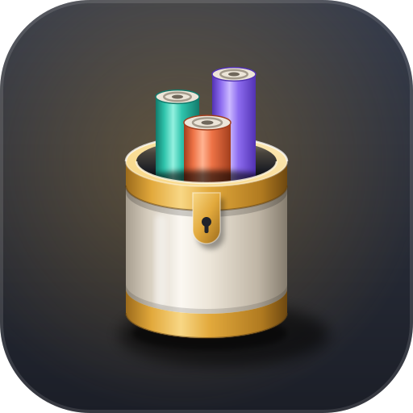

<div align="center">


# Capsa

**Tools for coding agents, in one repository.** Each tool has its own version, tag and release.

[](https://github.com/LuMiSxh/capsa/actions/workflows/ci.yml)
[](rust-toolchain.toml)

[](LICENSE)

**[acus](acus/README.md)** · [census](census/README.md) · [pons](pons/README.md) · [vicarius](vicarius/README.md)

</div>

## Tools

| Tool         | What it does                                                           | Docs                         |
| ------------ | ---------------------------------------------------------------------- | ---------------------------- |
| **acus**     | Code search, outline and editing for coding agents.                    | [README](acus/README.md)     |
| **pons**     | Transparent stdio proxy between Zed and the Claude ACP adapter.        | [README](pons/README.md)     |
| **census**   | Usage, limits, budget and context awareness for Claude Code and Codex. | [README](census/README.md)   |
| **vicarius** | Routes Claude Code subagents to DeepSeek while credit lasts.           | [README](vicarius/README.md) |

## Install

```sh
./install.sh              # all tools
./install.sh acus pons    # selected tools
```

```powershell
.\install.ps1             # acus, pons, census and vicarius
.\install.ps1 acus        # selected tools
```

Each tool installs from the newest release tagged `<tool>-v<version>`. The binaries go to `~/.local/bin` (`%USERPROFILE%\.local\bin` on Windows); set `CAPSA_INSTALL_DIR` to change that. `CAPSA_INSTALL_SCOPE=system` adds the directory to the system-wide PATH instead of the user PATH. The installer runs `acus self skill --install --target all` after installing acus, which writes the skill for Claude Code and Codex; set `CAPSA_NO_SKILL=1` to skip it.

The installers send a GitHub token when one is available (`GITHUB_TOKEN`, else `gh auth token`), which lifts GitHub's rate limit for anonymous requests. None is required.

Uninstall with `./install.sh --uninstall <tool|all>` or `.\install.ps1 -Uninstall <tool|all>`. It removes each binary from the directory the installer uses, and the acus skill unless `CAPSA_NO_SKILL` is set.

Management commands about a tool itself sit under `self`: `acus self update|setup|doctor|skill|uninstall`, `census self update|setup|doctor|skill|config|uninstall`, `pons self update|setup|doctor|uninstall`, `vicarius self setup|start|stop|doctor|config|update|uninstall`. `acus self setup` and `census self setup` register their hooks in Claude Code's `settings.json`, which the installers do not do. `pons self setup` installs the Claude ACP adapter, and `vicarius self setup` installs its launchd service and hook.

## Build from source

```sh
cargo install --path acus/crates/acus-cli
cargo install --path census
cargo install --path pons --profile release-unwind
cargo install --path vicarius
```

The toolchain is pinned in `rust-toolchain.toml`. pons uses the `release-unwind` profile, which keeps panics unwinding for its failsafe.

## Releases

Each tool has its own version in its `Cargo.toml` and its own section in its `CHANGELOG.md`. The `release` workflow takes a `tool` and a `version`, builds the binaries and publishes the GitHub release `<tool>-v<version>` with the notes from that changelog section.

## License

MPL-2.0. See [LICENSE](LICENSE).
