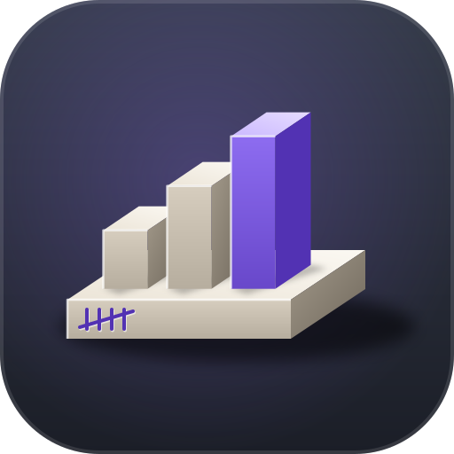

<div align="center">


# census

**Usage analytics for Claude Code and Codex.** Tokens, cost, tool calls and subagent roles from the session transcripts, plus context awareness, subscription limits and API budgets for the running session.

[](https://www.rust-lang.org/)

[](../LICENSE)
[](CHANGELOG.md)

**[capsa](../README.md)** · [Changelog](CHANGELOG.md)

</div>

Census is one of the [tools in capsa](../README.md#tools). Its design is in [PLAN.md](PLAN.md).

## Install

Install the release build with the capsa installer, then wire census into Claude Code:

```sh
./install.sh census           # macOS and Linux
.\install.ps1 census          # Windows
census self setup             # hooks and status line, see Hook
```

Build from source, with the toolchain pinned in `rust-toolchain.toml` (see [Build from source](../README.md#build-from-source)): `cargo install --locked --path census`.

## Commands

`census <command>` prints its report to stdout. It reads `~/.claude/projects` and `~/.codex/sessions` (or `CLAUDE_CONFIG_DIR` and `CODEX_HOME`).

| Command                                                       | What it does                                                                                                     |
| ------------------------------------------------------------- | ---------------------------------------------------------------------------------------------------------------- |
| `census usage`                                                | Token, cost and tool-call statistics from the transcripts; options below                                         |
| `census context [--session ID]`                               | Context tokens against the compaction threshold, the share used and the tokens left                              |
| `census session [--session ID]`                               | Duration, requests, subscription cost, API spend per provider, subagents per role, context and compactions                                            |
| `census limits`                                               | The two subscription windows (plan mode) or the month's spend against the budget (budget mode); see Limits and Budget mode |
| `census statusline [--line]`                                  | Records limit snapshots from Claude Code's `statusLine` input; `--line` prints `ctx 44k/400k · 5h 6% · wk 1%`    |
| `census prune --before YYYY-MM-DD \| --keep DAYS [--dry-run]` | Deletes hourly aggregates and snapshots older than the cutoff; raw ledger rows stay                              |
| `census hook`                                                 | Claude Code hook for `UserPromptSubmit` and `PostToolUse`; see Hook                                              |
| `census self …`                                               | Skill, setup, config, doctor, update and uninstall; see Self                                                     |

`census usage` options: `--days N` (transcripts modified in the last N days), `--project TEXT` (sessions whose working directory contains TEXT), `--top N` (rows per table, default 10), `--claude-dir DIR`, `--codex-dir DIR`, `--tools` (how agents search, read, edit and build, with the p50, p90 and largest result size per category), `--misses` (with `--tools`: the most frequent commands of the categories that bypass acus, with the calls that ran unguarded, the intercepted calls and result characters), `--guard` (`acus guard` decisions per rule and the escaped calls, from acus's `guard.jsonl`), `--agents` (one row per role: spawns, models, requests, cost, cache hit rate, cache rewrites), `--handbacks` (spawns per ISO week and the hand-back heuristic), `--compare YYYY-MM-DD` (the report before and after a UTC date), `--by weekday|hour|cycle` (expected cost per bucket, see Limits).

Output is agent text by default. `--human` adds colour on a terminal, `--json` prints the report as JSON, and `--format agent|human|json` is the same choice. `NO_COLOR` turns colour off. Exit codes are 0 for results, 1 for nothing found and 2 for an error; `census hook` always exits 0.

## Usage reports

Cost is the list price of each request (`src/usage/prices/`): input, output and cache reads at the model's rates, cache writes at the model's 5-minute and 1-hour rates. The prices are LiteLLM's (`model_prices_and_context_window.json`) for the Anthropic, DeepSeek and OpenAI chat models. `census usage`, `census limits` and `census session` keep them in `prices.json` in the state directory and fetch them again after 7 days (`census self config set prices-refresh-days <days>`); before the first fetch the snapshot built into the binary is used. A request above a model's long-prompt threshold, such as 100k prompt tokens for Haiku 5.5, pays its tier. A model without a price shows `n/a`.

Each request is billed to the provider of its model: `anthropic` (the Claude subscription), `deepseek` or `openai` (API spend). `census usage` names the provider of each model and totals each provider under `providers`; `census session` shows the API spend of its subagents under `api`. A model the price list does not know is `anthropic` when its id starts with `claude`, else `unknown`, which no view counts toward the limits.

A thread is one transcript file: the main session or one subagent. Cache hit rate is `cache_read / (input + cache_read + cache writes)`. A cache write after a gap longer than the TTL (1 hour in the main thread, 5 minutes in a subagent) is an expired-cache rewrite; a write within the TTL whose cache writes are over half the context is an unexpected bust. The first request after a compaction (its context under half the previous request's, or a compact boundary before it) that writes cache counts as a compaction, apart from both. `<synthetic>` messages (aborts and errors) are not requests.

A hand-back is a senior-worker spawn that starts within 30 minutes after a worker spawn of the same session ended (or started, if its end is unknown). The rate is hand-backs per worker spawn, per ISO week of the spawn's start. `--compare` splits requests at midnight UTC of the date.

## Billing

`billing` in `config.json` says how each provider bills its requests: `subscription` or `api`. `anthropic` is the subscription by default, and a provider the map does not list is `api`. `census self config set billing openai subscription` sets one provider, for example a Codex plan that has since been cancelled, so its history counts as subscription; `census self config set billing anthropic api` sets Claude to API spend. `census usage` names each provider's billing on the `providers` row and in a `billing` column of the models table, and `census session` shows the requests billed as subscription as `subscription` and the others as `api`. The JSON of `census session` keeps `cost` for the subscription share as set.

The limits do not follow `billing`: `census limits`, the status line, the hook, the budget month and `census usage --by` count only `anthropic` requests, whatever the setting says, because the five-hour and weekly windows track Claude's own limits.

## Limits

`census limits` estimates the five-hour and the weekly subscription window and forecasts the weekly one, in list-price cost from the ledger. Only requests billed to `anthropic` count: DeepSeek and OpenAI spend never move the windows, the forecast or the budget, and the `billing` setting does not change that.

- **Calibration**: per window, each snapshot gives `used_percentage` divided by the cost of the window up to the snapshot. `k` is the median of the last 20 points within 30 days; points under $0.01 or at 0 % are skipped, and the spread `(p75 - p25) / k` needs four points.
- **Estimate**: a snapshot under two minutes old is the reading; otherwise the share is `k` times the cost since the window start. A weekly window past its reset repeats every seven days; a five-hour window starts at the first request after its reset.
- **Burn rate**: the list-price cost of the last 15 and 60 minutes, per hour. `full around` is when 100 % is reached at the 60-minute rate, otherwise `lasts until reset`.
- **Pattern**: the cost of every hour of the history, weighted by `0.5^(age / 28 days)`, keyed by weekday and hour (or by hours since the weekly reset once two weeks map). Times are local.
- **Forecast**: the share now plus `k` times the expected cost until the weekly reset; the first two hours use half the 60-minute rate and half the pattern. Output: `runs out around Sat 21:00` or `ends at about 30 % unused`.
- **Five-hour windows**: each starts at the first request after the previous one ended. The typical peak is the median of the highest share of the last 20 windows (three or more snapshots), else `k` times their cost.

Without a snapshot there is no calibration and only the burn rate shows. `census usage --by` prints the pattern buckets: `weekday` (expected cost per day), `hour` (per hour of the day, averaged over the weekdays) or `cycle` (per hour since the weekly reset, zero until two weeks are mapped).

## Budget mode

For API billing, `census self config set mode budget` replaces the subscription windows with a dollar budget, set in USD by `census self config set monthly-budget 100`. `census limits`, the status line and the hook then report the list-price spend of the local month against it. `census self config set mode plan` switches back. Budget mode counts only `anthropic` requests, whatever `billing` says.

- **Daily limit**: `census self config set daily-limit 8` fixes it in USD. The default `auto` derives it: what is left of the monthly budget before today, shared over the local days left, today included (0 once the budget is spent).
- **Thresholds**: `daily_thresholds` in `config.json` lists the percentages of the daily limit that are announced, `[50, 80, 100]` by default. Each is announced once per local day; past 100 %, each further full multiple of the limit is announced once.
- **Hook messages**: `census: daily budget 80%: $6.40 of $8.00 today; month $47 of $100, at this pace the month ends near $139.` At 100 % it reads `census: daily budget reached: $8.40 of $8.00 today; at this pace the month ends near $139 of $100. Wrap up the current task and tell the user before starting new work.` The monthly line follows in the same output.
- `census limits` and `census self config` show today's spend against the daily limit. `census --json limits` has `today` with `usd`, `limit` and `source` (`derived` or `fixed`).

## Context, sessions and status line

The session is `--session ID`, else `CLAUDE_CODE_SESSION_ID`, else `CLAUDE_SESSION_ID`, else the most recently modified main transcript whose recorded directory is the current one, an ancestor or a descendant; the output names the one it used. The compaction threshold is `CLAUDE_CODE_AUTO_COMPACT_WINDOW`, else `autoCompactWindow` in `settings.json` under `$CLAUDE_CONFIG_DIR` (or `~/.claude`), capped at the model's window and lowered by `CLAUDE_AUTOCOMPACT_PCT_OVERRIDE`. With none of them it is the model's window, labelled as an approximation.

`census statusline` records the limit snapshots of Claude Code's `statusLine` input in `$XDG_STATE_HOME/census/snapshots` (or `~/.local/state/census/snapshots`), skipping a reading identical to the last one of its window. `--line` prints the status line instead: context, 5-hour and weekly share.

## Hook

`census hook` serves Claude Code's `UserPromptSubmit` and `PostToolUse` events. It reads the hook JSON on stdin (at most 1 MB) and prints nothing, exit 0, unless the main agent has a new level to hear about, as `hookSpecificOutput.additionalContext`. Input with `agent_id` (a subagent) or another event gets nothing.

| Level                                                                                                                  | Shown                                                                                               |
| ---------------------------------------------------------------------------------------------------------------------- | --------------------------------------------------------------------------------------------------- |
| Context 60 % / 80 % of the compaction threshold                                                                         | Once per session; 80 % adds a handoff suggestion. Both show again after the context falls below 50 %. |
| 5h or weekly limit 75 % / 90 %                                                                                          | Once per window                                                                                     |
| 5h forecast to fill before its reset (window 50 % used, 30 min old); weekly forecast to run out before its reset (50 % used, two weeks of history mapped) | Once per window                                                                                     |
| Weekly reset within 12 h with at least 30 % left                                                                        | Once per window                                                                                     |
| Status line (context, 5h and weekly share) on the first prompt of a session or after more than 1 h without one          | Each such prompt; never with `PostToolUse`                                                          |

Budget mode adds the daily-budget levels described under [Budget mode](#budget-mode).

State is kept in `$XDG_STATE_HOME/census/hints/<session id>` (or `~/.local/state/census/...`): one level per line, keyed with the window's reset time. Errors go to `hook.jsonl` beside it (moved to `hook.jsonl.old` at 256 KB); `census self doctor` reports them. Limits are skipped when they take over 150 ms.

`census self setup` writes the hooks and status line into `~/.claude/settings.json` (or `$CLAUDE_CONFIG_DIR`):

```json
{
    "hooks": {
        "UserPromptSubmit": [{ "hooks": [{ "type": "command", "command": "census hook" }] }],
        "PostToolUse": [{ "hooks": [{ "type": "command", "command": "census hook" }] }]
    },
    "statusLine": { "type": "command", "command": "census statusline --line" }
}
```

An entry that runs census in another form (an absolute or quoted path, `.exe`, or the old `2>/dev/null ||` fallback) is replaced by the bare command; a bare entry is left alone. The commands need census on PATH; `census self doctor` warns when it is not. A `statusLine` that census does not own is skipped unless `--force` replaces it. Other keys keep their order. The file is replaced only when something changes, and the old one is copied to `settings.json.bak` first. Invalid JSON, or a `hooks` or event value of the wrong type, exits 2 and changes nothing. `--dry-run` writes nothing, the skill included.

## Self

`census self <action>` manages census itself. `census self setup` and `census self skill --install` install the skill as `~/.claude/skills/census/SKILL.md`.

| Command                                                             | What it does                                                                                                         |
| ------------------------------------------------------------------- | -------------------------------------------------------------------------------------------------------------------- |
| `census self skill [--install]`                                     | Prints the skill for the main agent; `--install` writes it                                                           |
| `census self setup [--dry-run] [--force]`                           | Installs the skill, then wires the statusLine and hooks into `settings.json` (see Hook)                              |
| `census self config [show]`, `census self config set <key> <value>` | Shows or sets `mode plan\|budget`, the monthly budget, the daily limit and `billing` (see Billing and Budget mode); `--json` for the document |
| `census self doctor [--json\|--human\|--agent]`                     | Checks the binary, config, skill, hooks, state files and hook log, one line per check; exit 1 when a check fails, warnings do not |
| `census self update [--check\|--force]`                             | Replaces the binary with the latest release, then reinstalls the skill                                               |
| `census self uninstall [--dry-run]`                                 | Removes the skill, then the binary; settings entries stay                                                            |

Update and uninstall need the `cmd-update` feature (on by default).

## Development

For the layout and conventions, see [AGENTS.md](AGENTS.md). CI runs:

```sh
cargo fmt --all --check
cargo clippy --workspace --all-targets --all-features --locked -- -D warnings
cargo test -p census
```

Release notes go in [CHANGELOG.md](CHANGELOG.md); the release process is under [Releases](../README.md#releases) in the capsa README.

## License

census is licensed under the [Mozilla Public License 2.0](../LICENSE).
